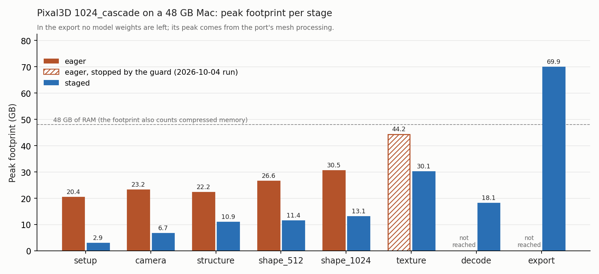
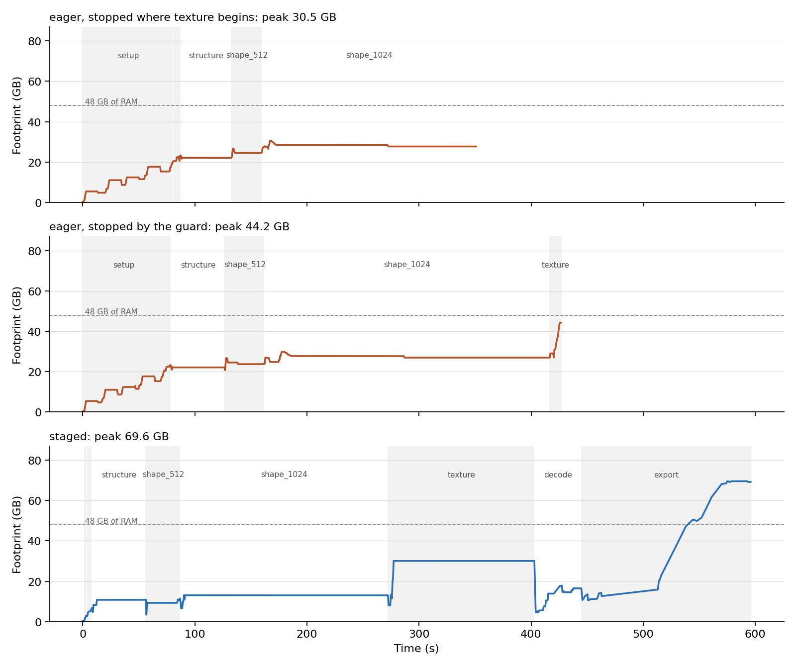
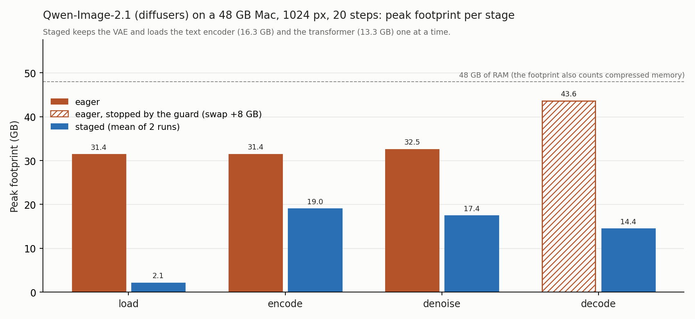

# stageload

Run multi-stage PyTorch pipelines on Apple Silicon with only the current stage's weights in memory.

```sh
pip install stageload
```

Measured on a 48 GB M5 Pro ([Results](#results) has the tables and traces):

- Pixal3D image-to-3D (`1024_cascade`): with eager loading the guard stopped the run in the texture
  stage at 44 GB. Staged loading finished both runs in about ten minutes and peaked at 30 GB while
  models were loaded; the port's mesh export, after every weight is released, goes higher.
- Qwen-Image-2.1 through diffusers, 1024 x 1024: the guard stopped eager loading and
  `enable_model_cpu_offload` in the VAE decode as swap grew. Staged loading peaked at 19 GB, and
  swap did not grow in either of its two runs.

Your own pipeline needs a loader per model and a list of models per stage ([example](#use-it-in-your-own-pipeline)),
and `on_call` attaches stages to code you do not own.



## Why

On Apple Silicon the CPU and the GPU share one pool of memory. The usual way to fit a big
pipeline, keeping idle models "on the CPU" and moving the active one to the GPU, frees nothing
there: both copies sit in the same RAM. Pixal3D runs in that mode by default (`low_vram` is on
unless its `pipeline.json` turns it off), so a `1024_cascade` run keeps all seven of its models
in memory for the whole run and copies the active one to MPS on top. It also loads the same
DINOv3 backbone four times, once per feature extractor.

stageload loads a model the first time a stage asks for it and releases it in place when the
pipeline moves to a stage that does not need it. Releasing moves the module's tensors to PyTorch's
`meta` device, which frees their storage even while other code still holds a reference to the
module. The design is in [docs/design/2026-10-04-stageload-design.md](https://github.com/nefayran/stageload/blob/main/docs/design/2026-10-04-stageload-design.md).

## Any pipeline that runs its models in turn

Nothing in the core knows about Pixal3D. A pipeline needs three things: a function that builds
each model on its own, the list of models each stage uses, and a call where each stage begins.
In code you own, that call is `models.enter("decode")`; in code you don't, `on_call` attaches it
to a method that already runs at that point, and the pipeline stays as it is. A text-to-image
pipeline (a text encoder, a denoiser and an image decoder, one after another) has the same shape;
Qwen-Image-2.1 through diffusers is the second pipeline measured
([results](#qwen-image-21-through-diffusers)). Pixal3D-mac is the first adapter;
[`bench/qwen_image.py`](https://github.com/nefayran/stageload/blob/main/bench/qwen_image.py) wires a diffusers pipeline without changing its
code, and [Use it in your own pipeline](#use-it-in-your-own-pipeline) shows the core on two models.

## Results

### Pixal3D

Pixal3D `1024_cascade` on an Apple M5 Pro with 48 GB, one image, seed 7, two runs per mode
([details and traces](https://github.com/nefayran/stageload/blob/main/bench/results/2026-10-05/README.md)):

| stage | eager, peak footprint | staged, peak footprint |
|---|---|---|
| setup | 20.4 GB | 2.9 GB |
| camera | 23.2 GB | 6.7 GB |
| structure | 22.2 GB | 10.9 GB |
| shape_512 | 26.6 GB | 11.4 to 11.5 GB |
| shape_1024 | 30.5 GB | 13.1 GB |
| texture | stopped by the guard at 44.2 GB (a run on 2026-10-04) | 30.1 GB |
| decode | – | 17.9 to 18.4 GB |
| export | – | 69.6 to 70.2 GB |

- Eager loading did not get through the texture stage on this machine. Within 10 s of entering
  it the footprint rose from 27 to 44 GB, available memory fell to 6 % and swap reached 27 GB,
  12 GB more than when the run started, so the guard stopped it. The other eager numbers come
  from runs stopped where the texture stage begins. Both staged runs finished, in about ten
  minutes each, of which 24 s went to loading models.
- Most of the texture stage's 30 GB is working memory, not weights: the texture model is 2.6 GB.
  When decoding began, releasing it and emptying the MPS allocator's cache brought the footprint
  down to 4.5 GB in one run and 8.0 GB in the other within two seconds.
- The highest staged footprint is the port's own mesh export, after every weight has been
  released; stageload does not change it.
- Output: the first latent (the sparse structure) is the same bit for bit in every run. From the
  next stage on, Pixal3D-mac does not repeat itself on MPS even with the same seed: the one pair
  of eager runs differed by 1.77 in the 512 shape latent, and staged runs differ from eager runs
  by 1.24 to 1.86. That shows any change from staged loading is no larger than the port's own
  variation; it cannot show there is none.

A staged run on a character image, rendered in Blender ([`bench/render_glb.py`](https://github.com/nefayran/stageload/blob/main/bench/render_glb.py)):


The footprint over time, for an eager run stopped where the texture stage begins, the eager run
the guard stopped, and a staged run:



### Qwen-Image-2.1 through diffusers

Text to image at 1024 x 1024, 20 steps, seed 7, on the same Mac
([details and traces](https://github.com/nefayran/stageload/blob/main/bench/results/2026-10-06-qwen-image/README.md)). Eager is the usual
`QwenImage21Pipeline.from_pretrained(...).to("mps")`. Staged keeps the VAE and loads the text
encoder (16.3 GB) and the transformer (13.3 GB) one at a time; the pipeline's code is unchanged.



| stage | eager, peak footprint | staged, peak footprint |
|---|---|---|
| load | 31.4 GB | 2.1 GB |
| encode | 31.4 GB | 19.0 GB |
| denoise | 32.5 GB | 16.2 to 18.6 GB |
| decode | stopped by the guard at 43.6 GB | 14.4 GB |

- Eager ran all 20 steps. The VAE decode then took its footprint from 32.5 to 43.6 GB and swap
  grew by 8 GB, so the guard stopped it before it wrote an image. Staged released the transformer
  before the decode, and its swap did not grow in either of its two runs.
- Model CPU offload did not finish either. The same run with
  `pipe.enable_model_cpu_offload(device="mps")` (one run, 2026-10-08,
  [trace](https://github.com/nefayran/stageload/blob/main/bench/results/2026-10-08-qwen-image-offload/README.md))
  kept the process footprint at 18.5 GB, but swap grew by 9.6 GB and the guard stopped it during
  the VAE decode, where it stopped eager. Footprint does not count pages already in swap, so a
  footprint-only comparison would make offload look like staged.
- Counted from the moment the transformer was in memory to the start of the decode, the 20 steps
  took 70 s and 99 s in the two staged runs and 77.5 s for eager; the traces do not show why the
  staged runs differ. Staged also spent about 13 s per run loading the two models and 4 to 5 s
  releasing the transformer.
- The two staged runs produced the same image, bit for bit. Eager produced none, so these runs do
  not show that both modes give the same image.

## How it works

- `StagedModels` is a dictionary of models that loads each one on first access. `enter(stage)`
  releases every loaded model the stage does not list. Checking `name in models`, `len()` and
  iterating names never load anything.
- Loading a model leaves the random generators where they were: torch's CPU, MPS and CUDA
  generators, Python's `random` and NumPy's global one. A pipeline that seeds once and draws noise
  stage by stage would otherwise get different noise, and a different result, as soon as a model
  is built in the middle of the run.
- `release(module)` moves every parameter and buffer to `meta`, collects garbage and empties the
  MPS cache. Calling a released module raises `ReleasedModuleError` with its name and the stage
  that released it, instead of PyTorch's error about meta tensors.
- `on_call(obj, method, before=..., after=...)` marks stage boundaries on an existing pipeline
  object, so its own `run()` executes unchanged.
- `share(owner, "from_pretrained")` makes identical loads return one instance for the duration of
  a block; the Pixal3D adapter uses it to give four extractors one DINOv3 backbone.
- `MemoryMeter` writes a JSONL trace: the process footprint (`phys_footprint`, the number
  Activity Monitor shows), swap and `kern.memorystatus_level` every 0.5 s, plus every load,
  release and stage change.

## Pixal3D-mac

Install [Pixal3D-mac](https://github.com/pawel-mazurkiewicz/Pixal3D-mac) with its own README, then
add stageload to the port's environment without touching its packages, and run it from there:

```bash
cd path/to/Pixal3D-mac
.venv/bin/pip install --no-deps git+https://github.com/nefayran/stageload
.venv/bin/stageload-pixal3d photo.png -o photo.glb
```

`--load eager` runs the port's own loading for comparison. Flags, stages and the bench are in
[docs/pixal3d.md](https://github.com/nefayran/stageload/blob/main/docs/pixal3d.md).

## The guard

`stageload guard` starts one command only when there is room for it, and stops it before swap
runs away. It needs no root, and the only processes it ever stops are the command and its process
group.

```bash
stageload guard --wait-free 40 --swap-budget 8G --busy 'ltx-2-mlx' -- python train.py
```

It waits until `kern.memorystatus_level` is at least `--wait-free` percent and no process has matched
a `--busy` pattern for `--quiet-for` (a minute by default, so the gap between two jobs of a chain
does not count as quiet), then runs the command. It stops the command if swap grows more than
`--swap-budget` over what was used at the start, or if available memory stays under `--kill-free`
(10 %) for two samples. Stopping means SIGTERM to the command's process group and, five seconds
later, SIGKILL to whatever of the group is left.

Exit code 3 means the guard stopped the command, 4 that it never found room to start it, and 127
that the command could not be started. If the guard itself gets Ctrl-C, SIGTERM or SIGHUP, it
stops the command first and exits with 128 plus the signal number; a second signal while the
command is shutting down sends SIGKILL at once. A signal the guard was started to ignore, such as
SIGHUP under `nohup`, stays ignored. Otherwise you get the command's own exit code, or 128 plus
the signal number if a signal ended it.

The `--busy` patterns match whole command lines, like `pgrep -f`. The guard leaves itself and the
shells that started it out, but any other process whose command line contains a pattern counts,
a shell running a script that mentions it included.

For a safety net across the whole machine, see
[macos-oom-guard](https://github.com/fl4p/macos-oom-guard), a root daemon that kills the largest
process before the kernel panics. The two do different jobs and can run together.

## One queue for the machine

`stageload guard` decides alone. Two guards that find room at the same moment both start, and a
guard can start in the gap between two jobs of another session's chain: on 2026-10-05 a run
started in such a gap, and the next video job took swap past its budget within 20 s. When several
agents or scripts share one Mac, start the heavy commands with `stageload run` instead. It takes
the guard's flags:

```bash
stageload run --who sayu-ltx -- ltx-2-mlx --distilled ...
```

- The command joins a lane, `ram` unless `--lane` names another, under `STAGELOAD_HOME`
  (`~/.stageload` by default). It starts once every older command of its lane has finished and
  it holds the lane's lock; then the guard's memory checks run as usual. Lanes do not wait for
  each other, so jobs bound by a remote quota (`--lane codex`) stay apart from the ones that need
  memory.
- Turns are fair between sessions: the owner who started least recently goes next, and each
  owner's own commands keep the order they joined in. A session that queues a batch takes turns
  with the others instead of holding the lane until the batch is done. The owner is `--owner`
  (or `$STAGELOAD_OWNER`), else the part of `--who` before its first dash.
- The command inherits the lane's lock, so the lane stays taken while it runs even if the process
  that queued it is killed with SIGKILL.
- A waiting run does not show the command in its own command line: `stageload run` writes it to
  a file and hands over, with the same pid, to `python -m stageload.queue <file>`. A guard waiting
  for the same engine would otherwise take the waiting run for the engine itself, and the two
  would wait for each other.
- Patterns in `~/.stageload/busy.txt`, one per line, are added to the `--busy` of every run in the
  `ram` lane, so all sessions wait for the same engines started outside the queue. Other lanes
  skip the list; a lane that needs no memory should also pass `--wait-free 0`.
- Each run writes a memory trace (by default under `~/.stageload/traces`; `--trace PATH`,
  `--no-trace`) with the footprint of the command and of every process under it, and appends one
  line to `~/.stageload/history.jsonl`: who, exit code, seconds waited and run, peak footprint and
  swap.
- Swap growth counts against the run that caused it. When several runs share the machine, each
  one compares its own memory growth with the others' (from their traces) and is charged only its
  share. A run that grew less than another is not stopped for swap. When free memory stays under
  `--kill-free`, the run that grew most in the last minute is stopped first; each of the others
  gets two more samples per run ahead of it. A run alone on the machine is judged as
  `stageload guard` judges its command.
- Memory taken by programs outside the queue pauses a run instead of stopping it. If swap passes
  the run's limit while the run's own footprint (it and its child processes) grew by no more than
  512 MB, or a quarter of the swap growth, over the last minute, the run's process group gets
  SIGSTOP. The log names the outside processes that hold the most memory. The run gets SIGCONT
  once the memory level is back at the start gate (`$STAGELOAD_GATE_LEVEL`, 35 %) or the outside
  processes have given back 1 GB. A run still paused after `$STAGELOAD_PAUSE_MAX_S` seconds
  (default 600; 0 turns pausing off), or one that hits `--kill-free` meanwhile, is stopped.
  `stageload queue` shows it as `paused`, and `history.jsonl` records `paused_s`. If the queue
  process itself dies while its command is paused, the next `stageload` command that reads the
  queue resumes the command.
- Before blaming outside programs, the run checks the other queued runs. If one of them grew in
  the last minute, the most recently started of those is paused instead, and the rest keep
  running. Only when no queued run grew is the pressure treated as coming from outside.
- No run starts while the machine is already short of memory: swap over
  `$STAGELOAD_GATE_SWAP_GB` (default 6), the memory compressor over
  `$STAGELOAD_GATE_COMPRESSOR_GB` (default 8, vm_stat's "Pages occupied by compressor") or the
  memory level under `$STAGELOAD_GATE_LEVEL` (default 35). These are current readings, not growth
  since a start. The run keeps its turn and checks again; `stageload queue` shows it as
  `mem-wait` with the reason.
- Swap alone does not hold a start when it is stale. macOS rarely reads swapped pages back in, so
  swap can stay high for hours after the memory pressure is gone. Swap over the gate is ignored
  when the compressor is at its gate or under and either the memory level is at
  `$STAGELOAD_GATE_STALE_SWAP_LEVEL` (default 50) or over, or no queued run is running on this
  machine and the level is at the start gate or over. The log says
  `starting although swap ... is stale` and why. A run with `--swap-limit` that starts this way
  counts its limit from the swap at its start plus its budget.
- A small run, one predicted at `$STAGELOAD_SMALL_JOB_GB` (default 1 GB) or less, not `--gpu`
  and not on a remote lane, waits only for swap over the gate or the level under
  `$STAGELOAD_PAUSE_LEVEL` (25), so it can start next to a big job. A command the history has not
  seen in a lane other than `ram` is predicted at 4 GB until it has a history. Commands that start
  an app through `open` are never small, because their trace cannot see the app's memory.
- One memory budget covers the whole machine. Each run has a predicted peak: `--mem-peak SIZE`
  when given; otherwise the larger of a built-in figure for a known engine on its command line
  (Blender `-b` 4 GB, Real-CUGAN or RIFE 3 GB, Whisper 3 GB, and others in the source) and 1.3
  times the largest peak `history.jsonl` has for the same `--who`. A numbered `--who` (its last
  part holds a digit, like `shot-c011`) with no history takes the largest peak of its numbered
  siblings. Otherwise it is 16 GB in the `ram` lane and 4 GB in the others. A run starts only when
  the predicted peaks of everything running or paused, its own, and `$STAGELOAD_RESERVE_GB`
  (default 16, for the OS and apps) fit the machine's RAM (`hw.memsize`); otherwise it waits in
  `mem-wait`. A run too big to fit even alone starts only when nothing else runs. The check and
  the start happen under one lock, so two lanes never take the last room at once. Give a script
  that runs a heavy engine inside it a `--mem-peak`: the queue cannot see the engine from the
  script's command line. The measured footprint cannot replace the peak either, because it misses
  most GPU (Metal) memory.
- The pause also triggers on absolute readings: swap over `$STAGELOAD_PAUSE_SWAP_GB` (default 9),
  the compressor over `$STAGELOAD_PAUSE_COMPRESSOR_GB` (default 12) or the level under
  `$STAGELOAD_PAUSE_LEVEL` (default 25), while the run's own footprint stayed flat. It resumes and
  times out like any pause. The swap and compressor readings are not waited for, because macOS
  swaps and compresses the paused run's own pages while it waits.
- Each trace sample also records `compressor_gb` and `wired_gb`.
- A `--gpu` run is never paused: a paused GPU job has its buffers swapped out and cannot recover
  in time. It keeps running under pressure and is stopped at once only when the memory level falls
  under 15 % twice in a row or swap passes its budget. When another queued run is to blame, that
  run is paused instead.
- Every pause and stop logs the five processes with the largest footprint, queued or not.
- `--gpu` (or `STAGELOAD_GPU=1`) also means the run never starts while another `--gpu` run is
  running in any lane. It keeps its place in its lane and waits for the GPU; GPU runs at the head
  of their lanes take turns in the same fair order.
- A command that fails within 10 s (not one stopped by the queue or a signal) holds its lane's
  next turn for its owner for 30 s, so a fixed command sent again gets the turn back.
- `--lane a,b` puts the run in several lanes at once. The first lane where it can start takes it,
  and the others drop it. The command gets the chosen lane in `$STAGELOAD_LANE`, so a script can
  run a remote tool on one lane and a local one on another.
- The `ram` lane runs two jobs at once (`$STAGELOAD_RAM_SLOTS`, default 2) when the budget and
  the start gate allow it. Two `--gpu` runs still never run together.
- `--what "..."` (default `$STAGELOAD_WHAT`) is a short plain description of what the run makes.
  `stageload queue` prints it after the fixed columns, and it is kept in the ticket, in
  `queue --json` and in `history.jsonl`.
- `--who` defaults to `$STAGELOAD_WHO`, `--start-timeout` to 24 hours and `--quiet-for` to 20 s,
  since waiting in the queue is the normal case. Exit codes are the guard's.

`stageload queue` shows what runs and what waits; `--history 10` adds the last ten finished runs,
`--json` prints JSON.

```
$ stageload queue
ram     0 running  sayu-ltx             pid 4242    since 2026-10-07T12:01:00+00:00  ltx-2-mlx --distilled ...
ram     1 waiting  haraiya-rife         pid 4310    since 2026-10-07T12:03:12+00:00  rife-ncnn-vulkan ...
light   0 mem-wait blender-build        pid 4377    since 2026-10-07T12:04:40+00:00  memory: budget: running 37.0 GB (...) + ours 4.0 GB + reserve 16.0 GB > RAM 48.0 GB  Blender -b ...
```

`stageload cancel` ends your own runs and leaves everyone else's alone. Use it instead of
`pkill -f stageload.queue`, which matches the queue process of every waiting run on the machine.

```bash
stageload cancel --who 'render-*'          # a glob on --who; or --owner NAME, an exact owner
stageload cancel --owner alice --lane light --dry
stageload requeue --since 2026-10-26T15:00Z --owner alice --dry
stageload reload --owner alice --dry
```

- `cancel` sends SIGTERM to each matching run. A waiting run exits before its command starts. A
  running command's process group gets SIGTERM, SIGCONT if it was paused, and SIGKILL after the
  grace period. `cancel` prints each run it ended, exits 1 when nothing matches, and with `--dry`
  only lists them. Each ended run is logged to `~/.stageload/cancelled.jsonl` with who, owner,
  lane, state, pid, what and who asked.
- Tickets and `history.jsonl` keep each run's command (`argv`), `cwd` and the flags of
  `stageload run` (`run_args`, with values taken from the environment written out), so a run can
  be started again. A run ended by a signal while waiting also gets a history line
  (`"state": "waiting"`); it does not count as a turn.
- `requeue --since TIME` starts again, detached, each run that a signal ended after that time and
  that has not been queued or finished since. `cancel`ed runs are skipped. Output goes to
  `~/.stageload/requeued/<who>-<time>.log`. `--owner` narrows it, and `--dry` only prints.
- `reload` restarts waiting runs on the stageload version installed now. A running process keeps
  the code it started with, so after an upgrade the runs already waiting still follow the old
  rules. Each waiting run is ended and started again with its own command, flags, environment,
  working directory and output file, and its new ticket keeps the old ticket's place in the lane
  (`$STAGELOAD_TICKET_NS`). Running and paused runs are never touched. A run whose parent process
  waits for its exit code is left alone and listed, since ending it would look like a failure to
  that parent. The exceptions are wrapper scripts named in `$STAGELOAD_RELOAD_WRAPPERS`
  (`name.py`, or `name.py:--flag` to skip calls that pass that flag): when the wrapper itself was
  started detached, the whole wrapper is restarted. `--end-for-retry` is for scripts that queue
  the same `--who` again when a run ends before it starts. Such runs are ended, and their place is
  kept for ten minutes in `~/.stageload/places/<who>.json` for the next `stageload run` of that
  `--who`.

## Use it in your own pipeline

```python
import torch
from safetensors.torch import load_file
from stageload import StagedModels

DEVICE = "mps"

def loader(cls, path):             # cls: one of your nn.Module classes
    def load():
        with torch.device(DEVICE):  # built on the GPU, not on the CPU and then moved
            model = cls()
        model.load_state_dict(load_file(path, device=DEVICE))
        return model.eval()
    return load

models = StagedModels(
    {"encoder": loader(Encoder, "encoder.safetensors"),
     "decoder": loader(Decoder, "decoder.safetensors")},
    stages={"encode": ["encoder"], "decode": ["decoder"]},
)

models.enter("encode")
latent = models["encoder"](image)   # loaded here
models.enter("decode")              # the encoder is released here
mesh = models["decoder"](latent)
models.close()
```

## Limits

- The meter and the guard read macOS counters (`libproc`, `sysctl`). The registry and `release`
  work wherever PyTorch runs.
- One adapter so far: Pixal3D-mac, tested at commit `0be9e69`, and staged loading has a plan for
  its `1024_cascade` pipeline only.
- A staged Pixal3D pipeline serves one image; the command builds a new one per image.
- The Qwen-Image wiring is a bench script for one pipeline, run with diffusers from main
  (0.41.0.dev0), not a packaged adapter.
- stageload builds Pixal3D's models directly on MPS, where the port builds them on the CPU. The
  sparse attention's rotary frequencies, computed when a model is built, then come out slightly
  different (up to 6e-8 apart). Because the port does not repeat its sparse stages on MPS with the
  same seed, a staged result can only be checked against eager within that run-to-run spread,
  and the texture latent and the final GLB were not compared at all.
- The meter samples from a thread inside the process. While native code holds the interpreter
  lock it takes no samples, so a short peak inside such a call can be missed.

## License

MIT. Pixal3D and Pixal3D-mac are MIT-licensed as well and are not included here; the adapter
imports the port at run time.
